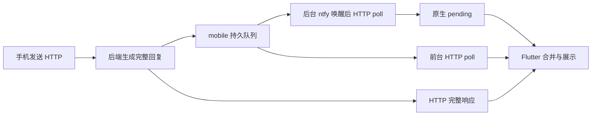

# 手机消息延迟、代理卡住与传输重构审计

日期：2026-10-24；工单：41。源码基线：mobile `1b42f36`、backend `dfba6bc`；桌面只读对照。审计结论不是线上部署版本或真机故障归因。

## 结论

需要重构的是网络请求的期限/取消、前台收件循环和消息交接可靠性。前台采用独立 WebSocket + HTTP 是合理的后续方向，但仅替换传输协议不会解决 VPN 路由故障，也不会补上持久化/确认漏洞。第一阶段沿既有 HTTP 长轮询即可改善完整消息到达速度与恢复，不必先扩大协议。

用户现象已收窄为：聊天界面开着，使用 V2Ray 类手机代理、连接服务器地址时容易卡住。与此最相关的是 A1/A2；B1 是独立后台问题，不能用它解释持续前台的故障。

## 实际调用链

- 桌面：HTTP 发起，符合条件时 WS 提前返回 token，最后以 canonical 消息/HTTP 对账。后端 `admin/routers/chat.py:314` 的流式条件同时要求 provenance/live origin 为 desktop，手机不会进入该流式分支。
- 手机前台：`MainActivity.kt:62` 在 onResume 停止后台服务与补偿 alarm；Flutter `app_shell.dart:298` 恢复轮询。前台并非一直由 ntfy 推送，不能只看中继连通。
- 手机后台：`MainActivity.kt:72` 按开关/凭据/可信 origin 启动服务；ntfy 只带 signal，正文回源认证 HTTP。
- `request_id` 是逻辑请求，`turn_id` 是持久回合，`msg_id/id` 是投递身份，`seq` 是队列顺序；任何重构都不可混用。

下文 Flutter 路径相对本仓；Kotlin 文件均位于 `android/app/src/main/kotlin/com/presencekit/mobile/`；标为「后端」「桌面」的路径相对对应仓库。

## A：前台与代理

### A1 / P1：建立 HTTP 请求阶段没有完整期限，会把收件单任务一起挂住

证据：`lib/services/backend_client.dart:210-267` 每次创建 HttpClient，设 8 秒 connectionTimeout；直接 await getUrl/postUrl，只有 request.close 和 body.join 才分别套 timeout。`pollMobile:403-416` 配置 live poll 响应超时 15 秒，但 getUrl 未完成时这个计时尚未开始。`lib/controllers/chat_controller.dart:1144-1172` 的 `_foregroundDelivery` 和 `pollingMobile` 要等这个请求结束才释放；后续 timer 会复用未完成任务，不能自救。

**实际故障注入已复现**：启动本地 TCP 假代理，真实 BackendClient 通过显式 HTTPS 代理发送 CONNECT，代理接受连接却不返回隧道响应。超过 8 秒连接期限后仍在途；追加一次前台收件仍复用原任务。16,011ms 时仍在途，pollingMobile=true，第二次调用没有新开请求；15秒poll响应timeout也尚未生效。不是单纯检查源码、不是调用伪造的永不完成 Future。

本机 Dart SDK `_http/http_impl.dart:2718-2751` 显示，socket 的连接 timeout 之后才执行 HTTPS proxy tunnel；应用未给整个打开请求阶段加 deadline。8 秒并不保证 CONNECT 在 8 秒结束。

**适用边界**：实验显式设置了 `findProxy`，不证明手机 V2Ray VPN 一定触发相同路径。当前 app 没有显式配置 findProxy；Dart 默认使用环境代理，而 Android VPN/TUN 路由是另一层。若手机仅使用 VPN 转发，这项实验是确定存在的传输缺陷，而实际触发点仍需手机日志/路由证据。

建议：统一网络层，对信任检查/打开请求/连接/请求头/正文设总期限和分阶段耗时；超时真实关闭请求/连接，确保单任务锁释放。网络变化和恢复前台触发取消旧代与立即补收。发送失败保持原 request_id，不自动重跑结果未知的工具回合。不能只对 Future.timeout 包一层却放任旧请求继续写状态。

### A2 / P1：网络切换没有主动恢复通路，前台健康也缺乏可见证据

已对 controllers/services、原生 Kotlin 目录和 pubspec 精准核对：没有默认网络 NetworkCallback/connectivity 监听。`pausePolling:174` 仅取消 timer，不取消在途 HTTP；`resumePolling:179` 发起 refresh，但 `refreshConnection:250` 和 `_foregroundDelivery` 各自复用旧任务。切代理/换网络后主要等旧请求结束，没有网络变更驱动的取消与重建。

Android 后台 SSE 最长读超时 90 秒，重连有 1–60 秒退避；与前台没有一个共同的网络 epoch/取消合同。不能把「后台服务 running」「上次 activate 成功」当作前台接收正常。

建议：网络 epoch + 显式请求取消；按网络变化、恢复前台、失败退避分别调度，不靠点设置或重开 app 解锁。只读展示最后一次 poll 成功/耗时、在途时长、最后已接收/落盘/交接的 seq；日志不保存 token、消息正文或完整敏感地址。

### A3 / P2：前台每 5 秒调度一次、每次只拉一页，没有连续收件循环

`chat_controller.dart:166-171` 每 5 秒 Timer；`1193-1197` live poll 用 wait=5（已有长轮询），默认每页20；`1291-1306` 保存/ack 后等待下次 timer，没有立即排空后页。单任务避免重入，但上一轮恰好结束在 tick 之后时会留下接近 5 秒空档；这里不是「每条必等5秒」，有在途 long poll 时入队会立即唤醒。

隔离实验验证后端 wait=5 在 enqueue 后 500ms 内返回。说明后端已有可用唤醒能力，无须先上 WS 才能及时接完整消息。前台500条 backlog 理论需25页，按5秒节拍是分钟级；后台已是50×10页排空，不能把后台修复当作前台已改。

此外 `_startInitialSync:151` 先等历史、再 replay/activate，`_refreshConnection:263` 也把历史放在 activate 前；历史网络异常会延迟首次收件建立。不是现有 timer 已运行后每次 poll 都被历史串行阻塞。

建议：独立前台收件循环；空队列长等，收到即下一页，有界排空，异常退避。history hydration 与收件可并行并经现有 reconciliation 合并；原 AppShell 不新增领域 Timer。

### A4 / P2：反复建连与等整段生成，放大代理网络下的体感差距

- `_request:220` 每个请求新建 HttpClient、finally:265 强制关闭；poll/ack/历史/发送不能共享这个连接池，HTTPS 链路频繁重建。桌面 `src-tauri/src/lib.rs:72-96` HTTP 明确 `.no_proxy()` 并有整体请求 timeout，手机默认策略不同。桌面 WS 是原生 socket，仍不能据此宣称绕过系统 VPN/TUN。
- 手机发送等完整生成（最长响应超时120秒），桌面符合条件时先展示 token。慢包含首字出现的差距，不只是最终消息传输。
- `chat_controller.dart:1647-1655` 分段呈现额外逐段等待，单段估时上限4秒再加100–1000ms；这是展示延迟，不是尚未收到。应分别测首字、最终消息、首个气泡与全部气泡出现。

建议：共享受控 HTTP transport（按 origin/身份/网络代际失效，允许并发 poll 与 send）；流式可做后续独立 WS，先解决请求恢复与重复建连。保留用户的 VPN 选择，不用不透明的强制绕 VPN 方案。

## B：后台与本机交接

### B1 / P1：唤醒后的回源失败没有及时重试，可等到15分钟补偿

`MobileNotificationService.kt:340-365` 取出 signalPending 后调用 pollOnce，忽略其 Boolean 失败结果；失败仅记 lastBackgroundError（531-649）。SSE 仍 connected 且没有新信号时，这个失败没有自己的秒级回源重试。安全补偿是15分钟（46、427-449），alarm 可能继续受系统调度影响，不是15分钟硬上限。中继可达而后端经代理不可达，就会出现「中继已连接但正文没到」。独立 WS 也必须有回源失败恢复，不能仅凭 socket 存活。

建议：为已接到 signal 但拉取失败保留待补收标志，有限指数退避重试；网络恢复立即补收；按当前消费代际取消，不并发双消费者。此项为源码确认，未做 Android 故障注入/真机复现。

### B2 / P1：consume 是删除式交接，前台持久证据也不等于可重放内容

`MobileDeliveryStateStore.kt:152-173` 在 MethodChannel 返回前删除匹配 pending；Flutter `chat_controller.dart:198-200` 在返回后还要校验 generation。若切换作用域导致迟到回包被丢，或 consume 后进程崩溃，原生已删、后端可能已ack，只能靠 canonical history 补救。前台 poll 则将 fresh 放内存/动画队列，持久化 seen 后 ack（1254-1306），没有先持久化完整正文的 inbox。seen 只证明处理过身份，不能重放气泡。

这是旧审计仍 open 的问题，不重复声称已修。后台 envelope 也缺 artifacts/sticker 等完整信息。建议统一 inbox + claim/ack 交接，展示成功确认后再清本机记录；网络投递确认与 UI 展示确认分开，保留角色隔离和未知结果保护。新增持久库/台账必须同单提供只读观测与容量/TTL策略。

## C：后端与互踢

### C1 / 当前无互踢；直接复用桌面 WS 会出问题

后端 `channels/desktop_ws.py:259-321` 全局 `_current_ws`，新连接主动关闭旧连接。手机当前只走 HTTP，不占这个位置；HTTP session grant 不等于抢占 socket。桌面 `src/shared/api/ws.ts:226` 收到 replaced 会停止自动重连，届时可能持续失去实时消息。`admin/scopes.py:36` 的 mobile profile 也没有 ws.desktop。

旧连接消息仍能更新共享 pong/ACK 的竞态已有记录，本轮只静态确认，未复现。它是单独的连接所有权缺口，不能当作当前手机已被踢的证据。

新 WS 必须是独立 `/ws/mobile` 或有明确 owner/device/client_type 身份和连接所有权的订阅层；先提供独立鉴权、连接代际、心跳、取消和断点补收，不能简单把手机指到 `/ws/desktop`，不能给手机 admin/desktop动作权限绕过。

### C2 / P1：ack 写盘失败仍报告成功

后端 `channels/mobile.py:154-164` 忽略 safe_write_json(False)，仍返回 remaining；router `admin/routers/mobile.py:134` 把它包装为 ok=true。故障注入得到 remaining=0，但重新 poll 仍有同一条消息；客户端按返回成功推进 after 后，又看不到该旧seq。重启/换设备可能重复收到。这不同于已经修复的「发送入队失败不反馈」。

建议最小修复 ack 的持久化失败传播，客户端仅在成功确认后推进游标；也审计 `_load_queue/_ensure_sequences` 修复写盘的返回值。后端与手机测试同时覆盖「失败 → 游标不前进 → 恢复 → 正常确认」。

### C3 / P2：共享队列只有一个消费者，传输升级不等于多手机可靠投递

`channels/mobile.py:154` ack 删除整个共享前缀，没有 device_id、独立手机游标。两个手机不是 socket互踢，但一个ack后另一个取不到；实验确认。桌面不消费这个 mobile 队列，所以不能把它解释成电脑把手机消息抢走。

当前单手机可以保留合同；若要求多手机/平板独立离线补收，需专门设计 per-device cursor、注册/撤销、容量与保留策略，不能顺手改变旧ack契约。无需为这次单手机症状先做该大改。

### C4 / P2：fanout 串行等待，后面的 durable mirror 可能被其他通道拖延

后端 `core/turn_sink.py:173-201` 顺序 await 各通道。`main.py:960-982` 正常注册 desktop/mobile/device/wechat/qq；mobile活跃时通常第二，不会总被QQ卡住；但 mobile不活跃、作为 durable mirror 追加到末尾时，前面的慢发送会推迟入队。隔离 slow-channel 实验已证明这一顺序依赖。desktop带behavior时也可能等动作ack最多5秒（`channels/desktop.py:92`）。

建议将 durable mobile持久化与其他通道网络发送的完成时间解耦，明确每通道期限和独立结果，保留真实的 fanout_failures。不要把慢后处理重新放回回复前；既有 detect_emotion 等已在 send 后调度，不列为未修根因。

## 方案选择与施工顺序

| 方案 | 能解决 | 不能独自解决 | 判断 |
|---|---|---|---|
| 修网络deadline/取消 + 连续HTTP长轮询 | 卡死恢复、整条消息到达、减少轮询空档 | token流式、VPN本身不可达、交接丢失 | 第一阶段必做，利用现有合同 |
| 独立前台WS + HTTP | 首字/工具进展实时、降低空轮询、断线状态明确 | 持久化、ack、多设备、VPN路由、Android强停 | 后续值得做；必须独立于桌面连接 |
| 前后台一直维持WS | 在线时实时 | Doze/OEM/强停与信号漏失 | 不作为手机后台唯一保证 |
| 仅缩短Timer/把手机接桌面WS | 局部体感 | 核心卡死和可靠性 | 不采用 |

有前置依赖的工作包：

1. **R0：现场观测与网络修复**。对照代理关/开/后端目标DIRECT，Wi-Fi/流量、开代理/关代理切换。需要实际安装版本、后端部署SHA与手机脱敏时序；补请求总期限、取消、网络恢复，复用原 request_id。先解决A1/A2，保留客户端既有连接状态入口。
2. **R1：收件循环与确认可靠性**（依赖R0的取消/网络代际）。连续poll、有界排空、历史并行对账、ack失败上抛、后台signal回源重试；本机inbox/claim-ack作为独立小单，新增状态须有观测。后端ack最小修复可与R0并行；不能把两边独立提交当成部署完成。
3. **R2：前台独立WS+HTTP**（依赖R1的补收与去重合同）。定义订阅作用域/权限与桌面同时在线不互踢，HTTP仍负责发送/附件/历史，WS推delta/canonical或唤醒；canonical仍有持久队列/游标，断线回HTTP补收。token片段不能作为最终消息ack。手机流式需要后端对应生成分支，新增socket不自动获得流式。
4. **R3：多设备投递**（仅产品需要时，依赖R1）。独立设计，不是R0/R2的前置。

## 三面闭环与验收要求

- 管理面：当前 `/settings/clients` 的 mobile connected 仅是活跃TTL，不是UI到达；`/settings/relay` 是配置，不是发布/回源成功率。后续需无正文的入队/ack/retention/失败、在途时长、每通道投递耗时观测。若引入 transport/重试策略等运营开关，必须有热更新设置、默认值和effective state，不能只放YAML。手机不持有管理权限来读这些值。
- 桌面/手机：桌面只读比对，保持v0.1旧连接合同；新mobile socket独立auth/owner/char/device。手机能力页只读观测，设置页才放策略/权限。后台继续尊重通知开关、授权和高风险动作确认。
- 全链：发送request → session/owner/char冻结 → 生成/工具 → sink/队列 → WS或poll/relay → 本机持久inbox → Flutter → UI/通知。逐项验证鉴权、关联键、去重、ack、TTL、取消代际、前后台handoff、fallback，未知结果不得盲重放。
- 验收矩阵：同一请求HTTP/poll/WS先后交错、代理开关/网络切换、CONNECT不回应、响应头卡住、正文卡住、ack落盘失败、超过一页积压、signal后回源失败、consume后切角色/杀进程、桌面同时在线、Doze/OEM后台。记录入队至落盘/展示的p50/p95与卡住恢复上限，不把LLM生成时长混进网络延迟。

## 本轮验证

- Flutter现有5文件定向回归：**78 passed**；未修改运行代码。
- 本地真实HTTPS代理CONNECT黑洞 + 前台收件实验：**1 passed**；16,011ms仍在途且第二轮未新开请求。结果见 `build/review/mobile-delivery-audit/proxy-probe.log`；可执行脚本 `audit_transport_probe_test.dart` 与日志同目录（ignored，仅本机证据）。不访问服务器、不用真实token。
- 后端3文件既有测试49项 + 4项审计注入：**53 passed**。注入覆盖ack假成功、双消费者共享删除、long poll即时唤醒、慢通道拖延离线mirror。使用Python3.12.13、tests/conftest.py的公开配置和隔离数据。
- 后端注入脚本本机副本：`build/review/mobile-delivery-audit/backend-probes.py`；原始日志在后端 `.tmp/mobile-delivery-audit-2026-10-24.log`。复跑时将脚本临时复制到后端tests目录，以加载该仓conftest；运行完删除临时测试，不把已知缺陷断言作为正式修复回归。
- `adb devices -l` 无设备；没有安装/构建APK、没有修改代理规则、没有登录线上后端、没有抓真实请求。**实际V2Ray模式、手机安装版本、服务器部署版本、真实卡住点均待现场核对**。Android后台故障注入、真机Doze/功耗本轮not-run。
- 历史记录仅用于定位，本轮重新核对当前源码与定向测试；没有把10月7/8日的修复重复列作现存已复现故障。

本轮仅审计文档，无跨端运行行为影响；未新增持久业务状态、开关或API。

官方资料：[Dart HttpClient与代理](https://api.dart.dev/dart-io/HttpClient-class.html)、[Android VPN与按应用路由](https://developer.android.com/develop/connectivity/vpn)、[默认网络变化回调](https://developer.android.com/develop/connectivity/network-ops/reading-network-state)。DIRECT/禁HTTP代理不等于绕过VPN/TUN；若现场仅开VPN，须用真实路由与分阶段耗时判断。